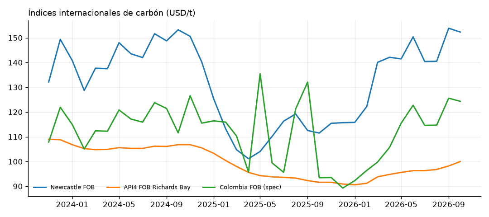
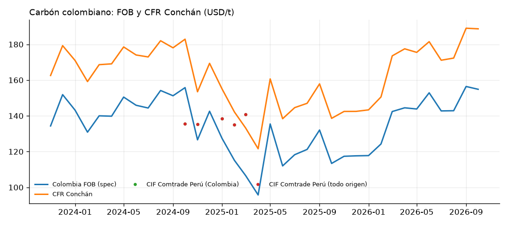
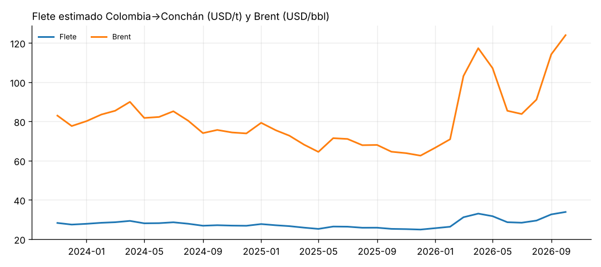
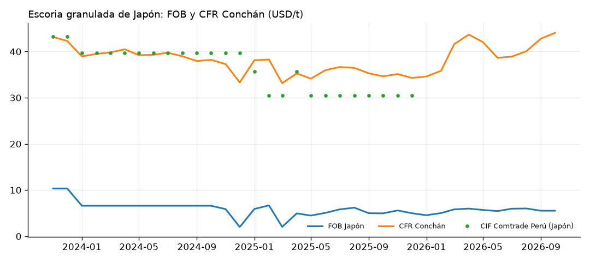
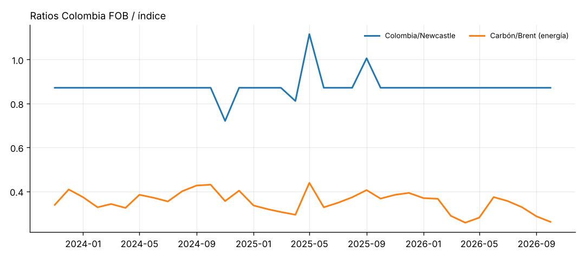

# Precios carbones internacionales — Puerto Conchán

_Actualizado: 2026-11-24 · Último mes con índice de referencia: 2026-10_

## Alertas

- ⚠ Flete Colombia→Conchán (USD/t) fuera de rango histórico: z=+2.2 vs 24 meses
- ▲ Brent (USD/bbl): +8.6% m/m (123.93, 2026-10)
- ⚠ Brent (USD/bbl) fuera de rango histórico: z=+2.3 vs 24 meses
- ⚠ Flete Japón→Conchán (USD/t) fuera de rango histórico: z=+2.2 vs 24 meses

## Carbón Colombia: FOB y CFR Conchán

| Concepto | Valor |
|---|---:|
| FOB Colombia, spec contrato (USD/t) | 154.86 |
| Flete marítimo Colombia→Conchán (USD/t) | 33.83 |
| CFR Conchán (USD/t) | 188.69 |
| CFR Conchán (PEN/t) | 649.62 |
| Referencia CFR (USD/t) | — |
| Fuente del FOB | estimado: Newcastle × ratio Colombia/Newcastle |

Spec 7000 kcal/kg NAR. Ratio Colombia/API2: 0.850 (valor por defecto); Colombia/Newcastle: 0.872 (calibrado con Comtrade). Factor de calibración del flete: 1.16.

## Escoria granulada de Japón: FOB y CFR Conchán

| Concepto | Valor |
|---|---:|
| FOB Japón (USD/t) | 5.52 |
| Flete marítimo Japón→Conchán (USD/t) | 38.53 |
| CFR Conchán (USD/t) | 44.05 |
| CFR Conchán (PEN/t) | 151.66 |
| Referencia CFR (USD/t) | — |
| Fuente del FOB | último dato disponible |

## Precios y costos

| Indicador | Mes | Último | m/m | a/a | Prom. 3m | Prom. 12m | Rango 24m | z 24m |
|---|---|---:|---:|---:|---:|---:|---|---:|
| Newcastle FOB (USD/t) | 2026-10 | **152.30** | -1.0% | +36.6% | 148.88 | 135.85 | 101.14 – 153.84 | 1.5 |
| API4 FOB Richards Bay (USD/t) | 2026-10 | **100.00** | +1.8% | +9.2% | 98.33 | 94.67 | 90.60 – 106.80 | 0.9 |
| Colombia FOB, spec contrato (USD/t) | 2026-10 | **154.86** | -1.0% | +36.6% | 151.38 | 138.13 | 95.74 – 156.42 | 1.6 |
| Flete Colombia→Conchán (USD/t) | 2026-10 | **33.83** | +3.8% | +34.1% | 31.96 | 29.21 | 24.87 – 33.83 | 2.2 |
| CFR Conchán (USD/t) | 2026-10 | **188.69** | -0.2% | +36.1% | 183.35 | 167.34 | 121.59 – 189.03 | 1.7 |
| CFR Conchán (PEN/t) | 2026-10 | **649.62** | +1.7% | +37.3% | 622.70 | 569.02 | 449.98 – 649.62 | 1.6 |
| CFR comparable con ofertas, con atenuantes (USD/t) | 2026-10 | **197.25** | -0.2% | +34.6% | 191.84 | 175.62 | 129.27 – 197.59 | 1.7 |
| CIF Perú desde Colombia — Comtrade (USD/t) | 2025-03 | **140.94** | +4.4% | — | 138.11 | 137.05 | 135.04 – 140.94 | — |
| CIF Perú desde todo origen — Comtrade (USD/t) | 2025-03 | **140.94** | +4.4% | — | 138.11 | 137.05 | 135.04 – 140.94 | — |
| Escoria FOB Japón (USD/t) | 2026-10 | **5.52** | +0.0% | +11.4% | 5.69 | 5.51 | 2.00 – 6.68 | 0.3 |
| Flete Japón→Conchán (USD/t) | 2026-10 | **38.53** | +3.3% | +29.8% | 36.62 | 33.80 | 29.31 – 38.53 | 2.2 |
| Escoria CFR Conchán (USD/t) | 2026-10 | **44.05** | +2.9% | +27.2% | 42.31 | 39.31 | 33.16 – 44.05 | 2.0 |
| Escoria CFR Conchán (PEN/t) | 2026-10 | **151.66** | +4.8% | +28.2% | 143.71 | 133.66 | 115.47 – 151.66 | 1.8 |
| Escoria CFR comparable con ofertas, con crédito (USD/t) | 2026-10 | **44.63** | +2.9% | +27.2% | 42.87 | 39.82 | 33.59 – 44.63 | 2.0 |
| Escoria CIF Perú desde Japón — Comtrade (USD/t) | 2025-12 | **30.48** | +0.0% | -23.1% | 30.48 | 31.34 | 30.48 – 39.65 | -1.1 |
| Brent (USD/bbl) | 2026-10 | **123.93** | +8.6% | +92.0% | 109.72 | 90.81 | 62.54 – 123.93 | 2.3 |
| Tipo de cambio (PEN/USD) | 2026-10 | **3.443** | +1.9% | +0.8% | 3.395 | 3.398 | 3.357 – 3.780 | -0.5 |
| Tipo de cambio (COP/USD) | 2026-10 | **3,195.20** | +0.3% | -17.7% | 3,170.46 | 3,521.24 | 3,130.92 – 4,412.06 | -1.7 |

## Ratios

| Indicador | Mes | Último | m/m | a/a | Prom. 3m | Prom. 12m | Rango 24m | z 24m |
|---|---|---:|---:|---:|---:|---:|---|---:|
| Colombia FOB / Newcastle | 2026-10 | **0.872** | -0.0% | +0.0% | 0.872 | 0.872 | 0.721 – 1.116 | -0.1 |
| Carbón vs Brent (USD/GJ ÷ USD/GJ) | 2026-10 | **0.261** | -8.8% | -28.9% | 0.292 | 0.329 | 0.257 – 0.439 | -1.7 |
| Flete / CFR | 2026-10 | **0.179** | +4.0% | -1.5% | 0.174 | 0.175 | 0.157 – 0.213 | 0.1 |
| CFR modelo / CIF Comtrade Perú | 2025-03 | **0.945** | -10.2% | — | 1.039 | 1.120 | 0.945 – 1.349 | — |
| Participación de Colombia en importaciones de Perú (t) | 2025-03 | **1.000** | +0.0% | — | 1.000 | 1.000 | 1.000 – 1.000 | — |
| Flete / CFR escoria | 2026-10 | **0.875** | +0.4% | +2.1% | 0.865 | 0.859 | 0.825 – 0.940 | 0.5 |
| Escoria CFR modelo / CIF Comtrade Perú | 2025-12 | **1.13** | -2.4% | +33.9% | 1.14 | 1.14 | 0.84 – 1.26 | 0.7 |

## Gráficos (últimos 36 meses)

## Estado de las fuentes (última descarga)

| Fuente | Observaciones | Estado |
|---|---:|---|
| fred | 317 | ✅ OK |
| banco_mundial | 318 | ✅ OK |
| bcrp | 107 | ✅ OK |
| comtrade | 26 | ⚠ Comtrade pe_imp_carbon_col_cif: sin registros (HTTP 200) {"elapsedTime":"0.04 secs","count":0,"data":[],"error":""} Comtrade co_exp_carbon_pe_fob: sin registros (HTTP 200) {"elapsedTime":"0.41 secs","count":0,"data":[],"error":""} Comtrade co_exp_carbon_mundo_fob: sin registros (HTTP 200) {"elapsedTime":"0.04 secs","count":0,"data":[],"error":""} |
| investing | 0 | — sin archivos |
| manual | 0 | — sin archivos |

## Frescura de datos por serie

| Serie | Último mes |
|---|---|
| `brent` | 2026-10 |
| `brent_bm` | 2026-10 |
| `carbon_bm_australia_fob` | 2026-10 |
| `carbon_bm_sudafrica_fob` | 2026-10 |
| `carbon_newcastle_fob` | 2026-09 |
| `co_exp_carbon_mundo_fob_usd_t` | 2026-04 |
| `co_exp_carbon_mundo_fob_vol_t` | 2026-04 |
| `co_exp_carbon_pe_fob_usd_t` | 2025-09 |
| `co_exp_carbon_pe_fob_vol_t` | 2025-09 |
| `fx_cop_usd` | 2026-10 |
| `fx_pen_usd` | 2026-11 |
| `jp_exp_escoria_mundo_fob_usd_t` | 2026-09 |
| `jp_exp_escoria_mundo_fob_vol_t` | 2026-09 |
| `jp_exp_escoria_pe_fob_anual_usd_t` | 2025-01 |
| `jp_exp_escoria_pe_fob_anual_vol_t` | 2025-01 |
| `jp_exp_escoria_pe_fob_usd_t` | 2026-08 |
| `jp_exp_escoria_pe_fob_vol_t` | 2026-08 |
| `pe_imp_carbon_col_cif_usd_t` | 2025-03 |
| `pe_imp_carbon_col_cif_vol_t` | 2025-03 |
| `pe_imp_carbon_mundo_cif_usd_t` | 2025-03 |
| `pe_imp_carbon_mundo_cif_vol_t` | 2025-03 |
| `pe_imp_escoria_jpn_cif_anual_usd_t` | 2025-01 |
| `pe_imp_escoria_jpn_cif_anual_vol_t` | 2025-01 |
| `pe_imp_escoria_jpn_cif_usd_t` | 2025-04 |
| `pe_imp_escoria_jpn_cif_vol_t` | 2025-04 |

---
_Fuentes: FRED/IMF, Banco Mundial (Pink Sheet), BCRP, UN Comtrade, CSV de Investing.com y cotizaciones propias. Los valores modelados son estimaciones; ver README para la metodología._
